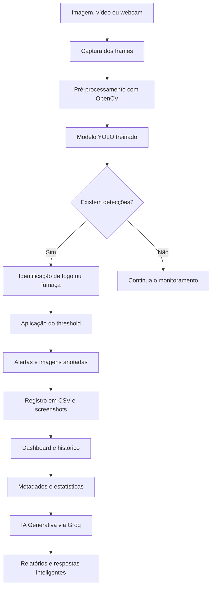
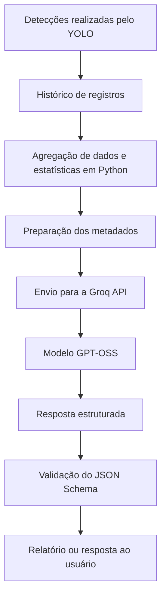

<<<<<<< HEAD
# 🔥 FireWatch AI

### Sistema inteligente de detecção de fogo e fumaça utilizando Visão Computacional e Inteligência Artificial Generativa

O **FireWatch AI** é um projeto acadêmico desenvolvido para detectar possíveis ocorrências de fogo e fumaça em imagens, vídeos e transmissões de webcam, utilizando técnicas de Deep Learning e Visão Computacional.

O sistema utiliza o modelo **YOLO (You Only Look Once)** para identificar fogo e fumaça em tempo real, registrar as ocorrências e apresentar os resultados em uma interface interativa desenvolvida com Streamlit.

Além da detecção visual, o projeto incorpora Inteligência Artificial Generativa por meio da API da Groq, utilizando modelos da família GPT-OSS para produzir relatórios técnicos, resumos e respostas sobre os registros realizados pelo sistema.

> ⚠️ **Aviso:** O FireWatch AI é um protótipo acadêmico e experimental. Não substitui sistemas certificados de detecção, prevenção e alarme de incêndio, nem deve ser utilizado como único mecanismo de segurança.

---

## 📌 Sumário

1. [Objetivos do projeto](#-1-objetivos-do-projeto)
2. [Arquitetura geral](#-2-arquitetura-geral)
3. [Pipeline de processamento de imagens](#-3-pipeline-de-processamento-de-imagens)
4. [Inteligência Artificial e modelos utilizados](#-4-inteligência-artificial-e-modelos-utilizados)
5. [Datasets utilizados](#-5-datasets-utilizados)
6. [Treinamento do modelo](#-6-treinamento-do-modelo)
7. [Avaliação e métricas](#-7-avaliação-e-métricas)
8. [Integração com IA Generativa](#-8-integração-com-ia-generativa)
9. [Funcionalidades da aplicação](#-9-funcionalidades-da-aplicação)
10. [Instalação e execução](#-10-instalação-e-execução)
11. [Estrutura do projeto](#-11-estrutura-do-projeto)
12. [Testes](#-12-testes)
13. [Limitações e trabalhos futuros](#-13-limitações-e-trabalhos-futuros)
14. [Referências](#-14-referências)
15. [Integrantes](#-15-integrantes)

---

## 🎯 1. Objetivos do projeto

O principal objetivo do FireWatch AI é desenvolver uma aplicação capaz de identificar possíveis ocorrências de fogo e fumaça por meio de imagens e vídeos, utilizando modelos de Inteligência Artificial.

### Objetivos específicos

- Aplicar técnicas de Visão Computacional e Deep Learning.
- Treinar um modelo YOLO para identificar fogo e fumaça.
- Processar imagens, vídeos e transmissões de webcam.
- Implementar técnicas de pré-processamento de imagens.
- Registrar automaticamente as detecções realizadas.
- Apresentar alertas visuais e informações em um dashboard.
- Integrar Inteligência Artificial Generativa para produzir relatórios técnicos.
- Avaliar o desempenho do modelo por meio de métricas de classificação e detecção.

### Classes identificadas

| Classe | Identificador | Descrição |
|---|---:|---|
| Fire | 0 | Fogo |
| Smoke | 1 | Fumaça |

---

## 🏗️ 2. Arquitetura geral

O projeto combina duas abordagens de Inteligência Artificial que desempenham funções diferentes e complementares.

| Componente | Tecnologia | Responsabilidade |
|---|---|---|
| Visão Computacional | YOLO / Ultralytics | Identificação de fogo e fumaça |
| Processamento de imagens | OpenCV | Captura, leitura e transformação dos frames |
| Aplicação | Python / Streamlit | Interface e monitoramento |
| Armazenamento | CSV / arquivos locais | Histórico e registros das detecções |
| IA Generativa | GPT-OSS via Groq API | Interpretação dos registros e elaboração de relatórios |

### Fluxo geral do sistema



A arquitetura separa a detecção visual da geração de informações em linguagem natural. Dessa forma, o modelo YOLO é responsável por identificar os objetos, enquanto o modelo generativo auxilia na interpretação e apresentação dos registros.

---

## 🖼️ 3. Pipeline de processamento de imagens

O pipeline representa todas as etapas realizadas desde a entrada de uma imagem ou vídeo até a apresentação e o armazenamento dos resultados.

### 3.1. Entrada de dados

O sistema aceita diferentes fontes de entrada:

- Imagens.
- Arquivos de vídeo.
- Transmissão de webcam.

No caso dos vídeos e da webcam, o OpenCV realiza a leitura e captura dos frames que serão encaminhados para o processamento.

### 3.2. Pré-processamento

Antes da inferência, o sistema pode aplicar transformações para preparar os frames.

As operações disponíveis incluem:

| Técnica | Objetivo |
|---|---|
| Resize | Redimensionamento da imagem |
| Gaussian Blur | Redução de ruídos e pequenas variações |
| Denoise | Redução de ruídos visuais |
| Ajuste de contraste | Alteração de brilho e contraste |
| BGR → RGB | Conversão de espaço de cores |
| BGR → HSV | Conversão para análise de matiz, saturação e valor |

O pré-processamento é configurável pela interface.

**Importante:** essas transformações são aplicadas na etapa de inferência, enquanto o treinamento utiliza as imagens originais preparadas pelo pipeline de datasets. O efeito de cada transformação precisa ser avaliado experimentalmente.

### 3.3. Detecção com YOLO

Após a preparação do frame, a imagem é encaminhada ao modelo YOLO treinado.

O modelo analisa os padrões visuais e retorna informações sobre os objetos identificados.

Entre os resultados estão:

- Classe identificada.
- Pontuação de confiança (*confidence*).
- Coordenadas da caixa delimitadora (*bounding box*).

As caixas delimitadoras permitem visualizar a localização dos possíveis focos de fogo e fumaça na imagem.

### 3.4. Aplicação do threshold

O threshold define a confiança mínima necessária para que uma detecção seja considerada válida.

O valor padrão utilizado na aplicação é **0.50 (50%)**, podendo ser alterado nas configurações.

Exemplo:

| Confiança identificada | Threshold | Resultado |
|---:|---:|---|
| 92% | 50% | Aceita |
| 68% | 50% | Aceita |
| 32% | 50% | Descartada |

Um threshold menor permite considerar mais detecções, mas pode aumentar os falsos positivos. Um threshold maior torna o sistema mais restritivo e pode aumentar os falsos negativos.

A confiança é uma pontuação produzida pelo modelo, não uma garantia de probabilidade real de incêndio.

### 3.5. Alertas e armazenamento

Quando uma detecção válida é identificada, o sistema pode:

- Exibir alertas visuais.
- Apresentar caixas delimitadoras na imagem.
- Registrar a ocorrência no histórico.
- Salvar capturas de tela.
- Atualizar os indicadores do dashboard.

Os registros são armazenados em arquivos CSV e as imagens correspondentes podem ser armazenadas na pasta de screenshots.

O sistema utiliza um intervalo mínimo entre registros (*cooldown*), configurado por padrão em 8 segundos por classe e origem, evitando a geração excessiva de registros repetidos.

### 3.6. Visualização dos resultados

As informações armazenadas alimentam a interface desenvolvida com Streamlit.

O usuário pode acompanhar o histórico, consultar indicadores, filtrar registros e exportar informações para análise.

---

## 🧠 4. Inteligência Artificial e modelos utilizados

O FireWatch AI utiliza modelos de IA especializados em duas tarefas: detecção visual e geração de linguagem natural.

### 4.1. YOLO — Visão Computacional

O YOLO (*You Only Look Once*) é uma arquitetura de Deep Learning utilizada para detecção de objetos.

No projeto, é utilizado o modelo **YOLO11n**, da família YOLO11, como peso inicial padrão para o treinamento.

A variante Nano foi escolhida por ser mais leve e adequada a experimentos acadêmicos que também podem ser executados em CPU.

O projeto possui fallback para YOLOv8n caso o peso padrão não esteja disponível. Também permite informar outro modelo por parâmetro.

Responsabilidades do YOLO:

- Identificar fogo.
- Identificar fumaça.
- Retornar a confiança das detecções.
- Localizar os objetos por meio de bounding boxes.
- Processar imagens e frames de vídeos e webcam.

O modelo treinado pelo projeto é armazenado em:

```text
models/fire_model.pt
```

### 4.2. GPT-OSS — Inteligência Artificial Generativa

Para a geração de relatórios e respostas inteligentes, o projeto utiliza modelos da família GPT-OSS, disponibilizados por meio da API da Groq.

| Modelo | Identificação | Utilização |
|---|---|---|
| GPT-OSS 120B | `openai/gpt-oss-120b` | Modelo padrão para relatórios e respostas |
| GPT-OSS 20B | `openai/gpt-oss-20b` | Alternativa mais leve |

O modelo utilizado pode ser configurado pela variável `FIREWATCH_GROQ_MODEL` ou pela interface, conforme a implementação disponível.

Responsabilidades da IA generativa:

- Elaborar relatórios técnicos.
- Resumir os registros das detecções.
- Apresentar estatísticas por classe.
- Identificar pontos de atenção.
- Responder perguntas sobre o histórico.

### 4.3. Por que utilizar dois modelos?

Os modelos possuem responsabilidades diferentes.

O YOLO realiza a análise visual e identifica possíveis ocorrências de fogo e fumaça.

Já o GPT-OSS recebe metadados e estatísticas produzidos pelo sistema e transforma essas informações em textos mais compreensíveis.

Essa integração permite combinar a capacidade de detecção visual com a geração automatizada de informações.

---

## 📚 5. Datasets utilizados

Para o treinamento e avaliação do modelo, o projeto utiliza datasets públicos de imagens anotadas de fogo e fumaça.

### 5.1. Indoor Fire Smoke Dataset

**Dataset principal do experimento padrão.**

- Aproximadamente 5.000 imagens reais disponíveis na fonte.
- Imagens de ambientes internos.
- Anotações de fogo e fumaça.
- Formato de bounding boxes.
- Divisão original de treino, validação e teste em 70/15/15.

Link: https://zenodo.org/doi/10.5281/zenodo.15826133

No modo acadêmico leve, o pipeline utiliza uma amostra reprodutível de 1.500 imagens, selecionadas com `seed=42`.

### 5.2. D-Fire Dataset

**Dataset adicional para experimentos e ampliação da diversidade visual.**

- Mais de 21 mil imagens.
- Imagens com fogo.
- Imagens com fumaça.
- Imagens contendo fogo e fumaça.
- Imagens sem ocorrência de fogo ou fumaça.
- Anotações no formato YOLO.
=======
# FireWatch AI

**Detecção de fogo e fumaça em vídeo e webcam com visão computacional (YOLO) e relatórios técnicos gerados por IA generativa.**

Projeto acadêmico de Deep Learning que implementa um pipeline reprodutível de Machine Learning, da coleta de datasets públicos à inferência em vídeo, com geração de alertas, registros e dashboard.

> **Aviso:** o FireWatch AI é um protótipo acadêmico e não substitui sistemas certificados de detecção e alarme de incêndio.

---

## Sumário

1. [Resumo](#1-resumo)
2. [Arquitetura de IA](#2-arquitetura-de-ia)
3. [Datasets](#3-datasets)
4. [Metodologia](#4-metodologia)
5. [Instalação e execução](#5-instalação-e-execução)
6. [Avaliação e resultados](#6-avaliação-e-resultados)
7. [IA generativa: relatórios inteligentes](#7-ia-generativa-relatórios-inteligentes)
8. [Estrutura do projeto](#8-estrutura-do-projeto)
9. [Testes](#9-testes)
10. [Limitações e trabalhos futuros](#10-limitações-e-trabalhos-futuros)
11. [Referências](#11-referências)
12. [Integrantes](#12-integrantes)

---

## 1. Resumo

O sistema detecta duas classes, `Fire` (0) e `Smoke` (1), em vídeos e imagens de webcam utilizando o **Ultralytics YOLO**. Quando há detecção, a interface exibe um alerta visual em tempo real; capturas de tela e registros em CSV são gerados com intervalo mínimo entre ocorrências (cooldown configurável, 8 s por classe e origem por padrão), e alimentam o dashboard em Streamlit.

O pipeline dispensa coleta e anotação manual de imagens: os scripts baixam datasets públicos, normalizam as anotações, removem duplicatas exatas, criam as divisões treino/validação/teste, treinam o modelo e avaliam o resultado.

```text
Datasets públicos → Coleta automática → Deduplicação → Normalização das anotações
→ Treino / Validação / Teste → Data augmentation → YOLO
→ Métricas (Precision, Recall, mAP50, mAP50-95) → Inferência em vídeo/webcam
→ Alerta + Screenshot + Log → Dashboard → Relatório por IA generativa
```

Por padrão, utiliza-se uma amostra reprodutível (`seed=42`) de **1.500 imagens reais**, com divisão aproximada de 70% treino, 15% validação e 15% teste. Isso permite executar o experimento completo em CPU, sem GPU dedicada.

Os datasets brutos e o arquivo `fire_model.pt` não acompanham o repositório por seu tamanho; ambos são gerados pelos scripts do projeto.

---

## 2. Arquitetura de IA

O sistema combina duas camadas com funções distintas:

| Camada | Tecnologia | Função |
|---|---|---|
| Visão computacional | YOLO (Ultralytics) | Detecta fogo e fumaça em cada frame e retorna classe, confiança e bounding box. |
| IA generativa | LLM via Groq | Interpreta os registros do YOLO e redige relatórios técnicos em português. Recebe apenas metadados e estatísticas, nunca imagens ou vídeos. |

A IA generativa não substitui a detecção visual, e seus relatórios não constituem confirmação de incêndio real.
>>>>>>> c21c03c13fc23059c95e2cb78ca48762c484a2f8

Composição informada pelo dataset original:

<<<<<<< HEAD
| Categoria | Quantidade de imagens |
|---|---:|
| Apenas fogo | 1.164 |
| Apenas fumaça | 5.867 |
| Fogo e fumaça | 4.658 |
| Sem fogo ou fumaça | 9.838 |

O dataset contém 14.692 bounding boxes de fogo e 11.865 bounding boxes de fumaça.

Links:
- Repositório: https://github.com/gaia-solutions-on-demand/DFireDataset
- Download e informações: https://github.com/gaia-solutions-on-demand/DFireDataset#download-links

### 5.3. Preparação dos datasets

O pipeline realiza automaticamente:

1. Download dos datasets selecionados.
2. Leitura das imagens e anotações.
3. Conversão das anotações para o formato YOLO.
4. Padronização dos identificadores das classes.
5. Remoção de duplicatas exatas utilizando hash SHA-256.
6. Divisão dos dados em treino, validação e teste.
7. Geração da configuração YAML utilizada pelo treinamento.

No caso do D-Fire, os identificadores originais das classes são remapeados para o padrão do projeto:

```text
0 = Fire
1 = Smoke
```

A deduplicação por SHA-256 identifica arquivos exatamente iguais, mas não elimina imagens visualmente semelhantes.
=======
## 3. Datasets

| | Indoor Fire Smoke (padrão) | D-Fire (opcional) |
|---|---|---|
| Imagens | 5.000 reais, ambientes internos (~200,5 MB) | Mais de 21 mil |
| Anotações | Bounding boxes de fogo e fumaça | Bounding boxes YOLO (14.692 de Fire e 11.865 de Smoke) |
| Divisão original | 70/15/15 | Treino/teste |
| Fonte | [Zenodo, DOI 10.5281/zenodo.15826133](https://doi.org/10.5281/zenodo.15826133) | [GitHub](https://github.com/gaia-solutions-on-demand/DFireDataset) |

- O **D-Fire** é baixado preferencialmente do Kaggle, com fallback para o espelho do Hugging Face (timeout ampliado, `hf_xet` e retomada de download). O caminho utilizado é salvo em `data_sources/dfire/.source_path`, evitando novos downloads.
- No D-Fire, o conjunto de teste oficial é preservado; apenas o conjunto de treino original é dividido em treino e validação (15%).
- O uso de mais de uma fonte aumenta a diversidade visual e reduz a dependência de um único domínio. O conjunto de teste permanece sempre separado, para medir a capacidade de generalização.
- Para usar todas as imagens do Indoor, em vez da amostra: `python scripts/prepare_dataset.py --sources indoor --max-images 0`.

---

## 4. Metodologia

### 4.1 Preparação dos dados

1. **Download automático** dos datasets públicos.
2. **Normalização das anotações** para o formato YOLO, aceitando labels `.txt` (YOLO) e `.xml` (Pascal VOC). No D-Fire, os índices de classe são remapeados (original: 0 = smoke, 1 = fire) para o padrão do projeto (0 = Fire, 1 = Smoke).
3. **Deduplicação** por hash SHA-256 do arquivo, que remove apenas duplicatas exatas, e não imagens visualmente parecidas.
4. **Divisão** em treino, validação e teste, com amostragem reprodutível (`seed=42`) e proporção 70/15/15 preservada quando `--max-images` é usado.

### 4.2 Treinamento

Fine-tuning de um modelo YOLO pré-treinado. O peso base padrão é o **YOLO11n** (versão *nano*, leve para CPU), com fallback para o `yolov8n`; outro peso pode ser informado com `--model`.

| Configuração | Modo acadêmico leve (padrão) | Treinamento completo |
|---|---|---|
| Dataset | Indoor, 1.500 imagens | D-Fire |
| Épocas | 10 | 30 |
| Resolução (`imgsz`) | 512 | 640 |
| Batch | 4 | 4 |

Parâmetros comuns, definidos em `scripts/train_model.py`:

| Parâmetro | Valor | Descrição |
|---|---|---|
| `patience` | 5 | Parada antecipada se não houver melhora |
| `mosaic` | 1.0 | Combinação de 4 imagens por amostra |
| `mixup` | 0.10 | Mistura de pares de imagens |
| `scale` | 0.50 | Variação de escala |
| `translate` | 0.10 | Deslocamento |
| `degrees` | 5.0 | Rotação máxima |
| `fliplr` | 0.50 | Espelhamento horizontal |

### 4.3 Pré-processamento na inferência

O módulo `detector/preprocess.py` é aplicado **somente na inferência** (vídeo e webcam), de forma configurável e independente do modelo: resize (960 px por padrão), Gaussian Blur, denoise, ajuste de contraste (ativado por padrão com alpha 1,08 e beta 2) e conversões BGR → RGB e BGR → HSV. O treinamento usa as imagens originais do dataset, sem essas transformações.

O projeto não pressupõe que cada transformação melhore o desempenho. A interface permite comparar a imagem original com a processada, e o efeito sobre as métricas deve ser verificado experimentalmente.

### 4.4 Experimento de thresholds

O modelo é avaliado no conjunto de teste com limiares de confiança `0.25`, `0.40`, `0.50`, `0.60` e `0.75`, registrando Precision, Recall, mAP50 e mAP50-95. O objetivo é evidenciar o compromisso entre falsos positivos e falsos negativos.

Observações para a interpretação:

- Por padrão, `validate_model.py` e `evaluate_experiments.py` avaliam com `imgsz=640`, enquanto o modo leve é treinado com `imgsz=512`.
- O mAP costuma ser calculado com um limiar de confiança baixo; ao aplicar limiares altos (como 0.75), os valores de mAP tendem a diminuir artificialmente. A comparação entre thresholds deve considerar principalmente Precision e Recall.

---

## 5. Instalação e execução

**Requisitos:** Python 3.10 ou superior (exigido pelo SDK `groq`; o `setup_and_train.bat` recomenda Python 3.11 ou 3.12) e conexão com a internet para o download dos datasets e dependências.

### 5.1 Execução automática (Windows)

```powershell
.\setup_and_train.bat
```

O script cria a `.venv`, instala as dependências, baixa e prepara o dataset, treina o modelo, copia o melhor peso para `models/fire_model.pt`, valida no conjunto de teste e executa o experimento de thresholds. Em seguida, inicie a aplicação:

```powershell
.venv\Scripts\python.exe -m streamlit run app.py
```

O script detecta GPU NVIDIA (CUDA) por meio do `nvidia-smi`. Sem ela, inclusive com GPU AMD no Windows, o treinamento é feito em CPU.

### 5.2 Execução manual

```powershell
# Ambiente
python -m venv .venv
.venv\Scripts\Activate.ps1
python -m pip install --upgrade pip
python -m pip install -r requirements.txt

# Pipeline completo
python scripts/run_pipeline.py --sources indoor --max-images 1500 --epochs 10

# Pipeline com os dois datasets
python scripts/run_pipeline.py --sources dfire indoor --max-images 1500 --epochs 10
```

Etapa por etapa:

```powershell
python scripts/download_datasets.py --datasets indoor
python scripts/prepare_dataset.py --sources indoor --max-images 1500
python scripts/train_model.py --epochs 10 --imgsz 512 --batch 4      # adicione --device 0 para GPU NVIDIA
python scripts/validate_model.py
python scripts/evaluate_experiments.py
```

Treinamento completo com o D-Fire:

```powershell
python scripts/download_datasets.py --datasets dfire
python scripts/prepare_dataset.py --sources dfire
python scripts/train_model.py --epochs 30 --imgsz 640 --batch 4 --device cpu
python scripts/validate_model.py
python scripts/evaluate_experiments.py
```

Teste rápido do modelo em imagem, vídeo ou webcam, fora da interface:

```powershell
python scripts/test_model.py caminho/da/imagem.jpg     # imagem
python scripts/test_model.py caminho/do/video.mp4      # vídeo (tecla Q para sair)
python scripts/test_model.py 0                         # webcam
```
>>>>>>> c21c03c13fc23059c95e2cb78ca48762c484a2f8

### 5.3 Uso da aplicação

| Página | Função |
|---|---|
| Início | Visão geral, indicadores e gráficos do histórico |
| Monitoramento | Upload de vídeo (MP4, AVI, MOV) e processamento frame a frame |
| Webcam | Detecção em tempo real pela câmera local |
| Histórico | Filtros, tabela de registros e exportação em CSV |
| Relatórios Inteligentes | Relatório técnico por IA generativa (TXT e PDF) |
| Assistente Inteligente | Perguntas em linguagem natural sobre o histórico |
| Configurações | Threshold, cooldowns, pré-processamento, webcam e recarga do modelo |

O threshold de confiança padrão é 0,50. Alertas visuais aparecem a cada frame com detecção; o alerta sonoro (`winsound`) e a captura da webcam via DirectShow (`CAP_DSHOW`) são específicos do Windows.

---

<<<<<<< HEAD
## ⚙️ 6. Treinamento do modelo

O treinamento utiliza transferência de aprendizado (*Transfer Learning*), partindo de pesos pré-treinados e realizando o ajuste do modelo para as classes de fogo e fumaça.

### 6.1. Configurações de treinamento

| Configuração | Modo acadêmico leve | Treinamento completo |
|---|---:|---:|
| Dataset | Indoor | D-Fire |
| Imagens | 1.500 | Conjunto disponível |
| Épocas | 10 | 30 |
| Resolução | 512 × 512 | 640 × 640 |
| Batch size | 4 | 4 |
| Seed | 42 | Configuração do pipeline |

Parâmetros adicionais:

| Parâmetro | Valor | Função |
|---|---:|---|
| Patience | 5 | Parada antecipada |
| Mosaic | 1.0 | Combinação de imagens |
| Mixup | 0.10 | Mistura de imagens |
| Scale | 0.50 | Variação de escala |
| Translate | 0.10 | Deslocamento |
| Degrees | 5.0 | Rotação |
| Fliplr | 0.50 | Espelhamento horizontal |

### 6.2. Saída do treinamento

Ao finalizar o treinamento, o melhor peso é copiado para:

```text
models/fire_model.pt
```

Esse arquivo é utilizado posteriormente pela aplicação para realizar as detecções.

Os arquivos de treinamento, gráficos, matriz de confusão e exemplos de predição são armazenados na pasta `runs/`.

---

## 📊 7. Avaliação e métricas

O desempenho do modelo é avaliado por meio de métricas utilizadas em tarefas de detecção de objetos.

### 7.1. Métricas utilizadas

| Métrica | Significado |
|---|---|
| Precision | Proporção de detecções positivas que estavam corretas |
| Recall | Proporção de objetos reais que foram identificados |
| mAP50 | Média da precisão considerando IoU de 0.50 |
| mAP50-95 | Média da precisão em diferentes limiares de IoU, de 0.50 a 0.95 |

Essas métricas permitem analisar a capacidade do modelo de identificar fogo e fumaça e avaliar a qualidade das detecções.

### 7.2. Experimento com diferentes thresholds

O projeto realiza experimentos utilizando cinco limiares de confiança:
=======
## 6. Avaliação e resultados

Ao final do pipeline, são gerados:
>>>>>>> c21c03c13fc23059c95e2cb78ca48762c484a2f8

```text
models/fire_model.pt              Melhor peso treinado
reports/evaluation_summary.csv    Métricas por threshold
reports/data_runtime.yaml         Configuração do dataset utilizado
runs/firewatch/train/             Curvas de treino, matriz de confusão e exemplos
```

<<<<<<< HEAD
O objetivo é comparar como diferentes valores afetam o equilíbrio entre falsos positivos e falsos negativos.

De maneira geral:

- Threshold baixo: tende a aumentar o Recall, mas pode reduzir a Precision.
- Threshold alto: tende a aumentar a Precision, mas pode reduzir o Recall.

A interpretação depende dos resultados observados no conjunto de teste.
=======
As métricas reportadas são Precision, Recall, mAP50 e mAP50-95, calculadas no conjunto de teste. A matriz de confusão e as curvas são geradas automaticamente pelo YOLO.

<!-- Inserir aqui a tabela com os resultados obtidos (Precision, Recall, mAP50, mAP50-95)
     e imagens de exemplo de detecção (acertos, falsos positivos e falsos negativos). -->
>>>>>>> c21c03c13fc23059c95e2cb78ca48762c484a2f8

**Observação:** o mAP é normalmente calculado considerando diferentes limiares de confiança. Ao comparar execuções com thresholds fixos elevados, é importante interpretar as métricas com cuidado, especialmente o mAP.

<<<<<<< HEAD
### 7.3. Arquivos gerados na avaliação

```text
models/fire_model.pt
reports/evaluation_summary.csv
reports/data_runtime.yaml
runs/firewatch/train/
```

- `fire_model.pt`: pesos do modelo treinado.
- `evaluation_summary.csv`: métricas por threshold.
- `data_runtime.yaml`: configuração do dataset utilizado.
- `runs/firewatch/train/`: resultados e evidências do treinamento.

Os valores efetivos das métricas devem ser consultados nos arquivos gerados pelo experimento.

---

## 🤖 8. Integração com IA Generativa

A integração com Inteligência Artificial Generativa foi desenvolvida para ampliar as funcionalidades do sistema, permitindo transformar os registros técnicos das detecções em relatórios e respostas em linguagem natural.

A comunicação é realizada por meio da **Groq API**, utilizando modelos GPT-OSS.

### 8.1. Pipeline da integração



### 8.2. Relatórios inteligentes

O sistema permite gerar relatórios técnicos em português contendo:

- Resumo executivo.
- Estatísticas por classe.
- Análise temporal.
- Pontos de atenção.
- Recomendações de verificação humana.
- Conclusão.

Os relatórios podem ser exportados nos formatos TXT e PDF.

### 8.3. Assistente inteligente

O assistente permite realizar perguntas em linguagem natural sobre o histórico de detecções.

Exemplos:

- Quantas detecções de fogo foram registradas?
- Qual classe apareceu com maior frequência?
- Quais foram os principais registros?
- Faça um resumo das ocorrências.

O assistente utiliza até oito mensagens anteriores como contexto da conversa.

### 8.4. Resumo automático

Ao concluir o processamento de um vídeo, o sistema pode gerar automaticamente um relatório dos registros produzidos naquela execução.

A funcionalidade é ativada por padrão, mas pode ser desabilitada na interface para evitar chamadas desnecessárias à API.

### 8.5. Privacidade e confiabilidade

A integração foi desenvolvida com cuidados específicos:

- Apenas metadados e estatísticas são enviados à Groq.
- Imagens e vídeos não são enviados à API.
- Caminhos locais e coordenadas das bounding boxes não são transmitidos.
- Os cálculos estatísticos são realizados em Python.
- O modelo generativo é responsável pela redação e interpretação textual.
- As respostas dos relatórios são validadas por meio de JSON Schema.
- O sistema utiliza cache de sessão para reutilizar relatórios idênticos.

A IA generativa não realiza a detecção visual e não confirma a existência de um incêndio real.

Mais detalhes sobre a integração podem ser encontrados em:

`docs/IA_GENERATIVA_GROQ.md`

---

## 💻 9. Funcionalidades da aplicação

A interface foi desenvolvida utilizando Streamlit e está organizada em diferentes páginas.

| Página | Funcionalidade |
|---|---|
| Início | Indicadores, gráficos e visão geral |
| Monitoramento | Processamento de vídeos enviados pelo usuário |
| Webcam | Detecção em tempo real |
| Histórico | Consulta, filtros e exportação de registros |
| Relatórios Inteligentes | Geração de relatórios técnicos com IA |
| Assistente Inteligente | Perguntas em linguagem natural sobre o histórico |
| Configurações | Threshold, cooldown, pré-processamento e webcam |

---

## 🚀 10. Instalação e execução

### 10.1. Requisitos

- Python 3.10 ou superior.
- Conexão com a internet para instalação das dependências e download dos datasets.
- Windows recomendado para o script de instalação automática.
- GPU NVIDIA com CUDA opcional.

Sem uma GPU NVIDIA compatível, o pipeline pode ser executado em CPU, embora o treinamento e a inferência possam levar mais tempo.

### 10.2. Clonar o repositório

```bash
git clone https://github.com/vasconcelosguu/FireWatch.git

cd FireWatch
```

### 10.3. Criar ambiente virtual

```bash
python -m venv .venv
```

Ativar o ambiente no Windows:

```powershell
.venv\Scripts\Activate.ps1
```

Atualizar o pip:

```bash
python -m pip install --upgrade pip
```

Instalar as dependências:

```bash
pip install -r requirements.txt
```

### 10.4. Configurar a API da Groq

Para utilizar as funcionalidades generativas:

1. Criar uma chave de API na plataforma da Groq.
2. Copiar o arquivo `.env.example` para `.env`.
3. Preencher a variável `GROQ_API_KEY`.

Exemplo:

```env
GROQ_API_KEY=sua_chave_aqui
```

Não compartilhe sua chave e nunca publique o arquivo `.env` no GitHub.

### 10.5. Execução automática no Windows

O projeto possui um script que automatiza a instalação, preparação dos dados, treinamento e avaliação:

```powershell
.\setup_and_train.bat
```

Após a conclusão do pipeline, iniciar a aplicação:

```powershell
.venv\Scripts\python.exe -m streamlit run app.py
```

### 10.6. Execução manual do pipeline

Download do dataset Indoor:

```bash
python scripts/download_datasets.py --datasets indoor
```

Preparação dos dados:

```bash
python scripts/prepare_dataset.py --sources indoor --max-images 1500
```

Treinamento:

```bash
python scripts/train_model.py --epochs 10 --imgsz 512 --batch 4
```

Validação:

```bash
python scripts/validate_model.py
```

Experimentos com thresholds:

```bash
python scripts/evaluate_experiments.py
```

Também é possível executar o pipeline completo:

```bash
python scripts/run_pipeline.py --sources indoor --max-images 1500 --epochs 10
```

Para utilizar os dois datasets:

```bash
python scripts/run_pipeline.py --sources dfire indoor --max-images 1500 --epochs 10
```

### 10.7. Teste individual do modelo

Imagem:

```bash
python scripts/test_model.py caminho/da/imagem.jpg
```

Vídeo:

```bash
python scripts/test_model.py caminho/do/video.mp4
```

Webcam:

```bash
python scripts/test_model.py 0
```

---

## 📁 11. Estrutura do projeto

```text
FireWatch/
│
├── app.py
├── requirements.txt
├── setup_and_train.bat
├── .env.example
├── .gitignore
│
├── .streamlit/
│   └── Configurações da interface
│
├── ai/
│   └── Prompts, relatórios e assistente inteligente
│
├── detector/
│   ├── detector.py
│   └── preprocess.py
│
├── interface/
│   ├── home.py
│   ├── monitor.py
│   ├── webcam.py
│   ├── history.py
│   ├── ai_reports.py
│   ├── ai_chat.py
│   └── settings.py
│
├── utils/
│   ├── video.py
│   ├── logger.py
│   └── alerts.py
│
├── scripts/
│   ├── download_datasets.py
│   ├── prepare_dataset.py
│   ├── train_model.py
│   ├── validate_model.py
│   ├── evaluate_experiments.py
│   ├── run_pipeline.py
│   └── test_model.py
│
├── tests/
│   └── Testes automatizados
│
├── docs/
│   └── IA_GENERATIVA_GROQ.md
│
├── data_sources/
│   └── Datasets brutos (gerados)
│
├── datasets/
│   └── fire_smoke/
│       └── Dataset preparado
│
├── models/
│   └── fire_model.pt
│
├── reports/
│   ├── evaluation_summary.csv
│   └── data_runtime.yaml
│
├── runs/
│   └── Resultados do treinamento
│
├── screenshots/
│   └── Capturas das detecções
│
└── logs/
    └── Histórico das detecções
```

**Observação:** algumas pastas e arquivos são criados automaticamente durante o download dos datasets, treinamento e execução da aplicação. Os datasets brutos e os pesos treinados não precisam estar versionados no repositório devido ao tamanho dos arquivos.

---

## 🧪 12. Testes

O projeto possui testes automatizados para verificar o funcionamento das funcionalidades relacionadas à integração generativa.

Os testes contemplam:

- Preparação dos dados enviados à IA.
- Geração de relatórios estruturados.
- Funcionamento do assistente.
- Tratamento de erros.
- Validação das respostas.
- Remoção de caminhos locais e coordenadas dos dados enviados à API.

Para executar:

```bash
python -m unittest discover -s tests -v
```

Os testes da integração utilizam um cliente simulado e não precisam consumir chamadas reais da API da Groq.

---

## ⚠️ 13. Limitações e trabalhos futuros

### Limitações

- O desempenho depende da qualidade, resolução e iluminação das imagens.
- Ambientes externos e condições diferentes das presentes no dataset podem afetar os resultados.
- O dataset padrão é voltado a ambientes internos.
- A deduplicação atual remove arquivos idênticos, mas não necessariamente imagens visualmente semelhantes.
- O treinamento utiliza imagens originais, enquanto a inferência pode aplicar transformações de pré-processamento.
- Os registros do histórico respeitam um cooldown e, portanto, não representam necessariamente todas as detecções realizadas em cada frame.
- A geração de relatórios depende da disponibilidade e dos limites da API da Groq.
- O modelo generativo pode produzir interpretações incorretas, por isso os relatórios devem ser revisados.
- O protótipo não possui certificação para utilização em sistemas reais de segurança contra incêndio.

### Trabalhos futuros

- Ampliar a quantidade e diversidade dos dados de treinamento.
- Avaliar o desempenho em ambientes externos.
- Comparar diferentes variantes da arquitetura YOLO.
- Investigar o impacto individual das técnicas de pré-processamento.
- Melhorar a detecção em situações de baixa iluminação.
- Aprimorar a análise temporal das ocorrências.
- Evoluir os mecanismos de alerta e monitoramento.
- Expandir as funcionalidades do assistente inteligente.

---

## 📖 14. Referências

**Modelos e tecnologias**

- [Ultralytics — YOLO](https://docs.ultralytics.com/)
- [OpenCV — Documentação oficial](https://docs.opencv.org/)
- [Streamlit — Documentação oficial](https://docs.streamlit.io/)
- [Groq — Documentação da API](https://console.groq.com/docs)
- [OpenAI — GPT-OSS](https://openai.com/index/introducing-gpt-oss/)

**Datasets**

- [Indoor Fire Smoke Dataset — Zenodo](https://zenodo.org/doi/10.5281/zenodo.15826133)
- [D-Fire Dataset — GitHub](https://github.com/gaia-solutions-on-demand/DFireDataset)

**Referência acadêmica do D-Fire**

Venâncio, P. V. A. B.; Lisboa, A. C.; Barbosa, A. V. *An automatic fire detection system based on deep convolutional neural networks for low-power, resource-constrained devices*. Neural Computing and Applications, 2022.

---

## 👥 15. Integrantes

Projeto desenvolvido por:

1. **Felipe Piovesan**
2. **Frederico Faben Brumati**
3. **Gustavo Vasconcelos Solomão**
4. **Ruan Gimenes**
5. **Vitor do Nascimento Zuchieri**
6. **José Roberto Miranda Neto**

---

<div align="center">

### 🔥 FireWatch AI

**Inteligência Artificial aplicada à detecção de fogo e fumaça.**

Projeto acadêmico desenvolvido para aplicação prática dos conceitos de Visão Computacional, Deep Learning e Inteligência Artificial Generativa.

[Repositório no GitHub](https://github.com/vasconcelosguu/FireWatch)

</div>
=======
## 7. IA generativa: relatórios inteligentes

O modelo padrão é o `openai/gpt-oss-120b`, acessado pela API da Groq e configurável por meio da variável `FIREWATCH_GROQ_MODEL` ou pela interface (alternativa mais leve: `openai/gpt-oss-20b`).

**Funcionalidades**

- **Relatórios Inteligentes:** relatório técnico em português com resumo executivo, estatísticas por classe, análise temporal, pontos de atenção, recomendações de verificação humana e conclusão, exportável em TXT e PDF. Relatórios idênticos (mesmos dados, modelo e versão do prompt) são reutilizados do cache da sessão, sem nova chamada à API.
- **Assistente Inteligente:** perguntas em linguagem natural sobre o histórico de detecções, com até oito mensagens anteriores como contexto.
- **Resumo automático:** na página de Monitoramento, ao concluir o processamento de um vídeo, é gerado um relatório apenas dos registros criados naquela execução. A opção vem ativada por padrão e realiza uma chamada à API por vídeo com novos registros; desmarque-a para não consumir tokens. Se não houver detecções ou a API estiver indisponível, o vídeo permanece processado e o histórico é preservado.

**Privacidade e confiabilidade**

- Somente metadados e estatísticas são enviados à Groq; imagens, vídeos, caminhos locais e coordenadas nunca são transmitidos.
- Os números dos relatórios são calculados em Python, e o modelo de linguagem apenas redige a interpretação.
- A resposta do relatório é exigida em JSON Schema estrito e validada antes de ser exibida.

**Configuração**

1. Copie `.env.example` para `.env`.
2. Defina `GROQ_API_KEY` com a sua chave.
3. Não publique o arquivo `.env` no repositório.

Detalhes sobre arquitetura, prompt, segurança, testes e limitações em [docs/IA_GENERATIVA_GROQ.md](docs/IA_GENERATIVA_GROQ.md).

---

## 8. Estrutura do projeto

```text
firewatch-ai/
├── app.py                      Aplicação Streamlit
├── setup_and_train.bat         Setup e treinamento automáticos (Windows)
├── requirements.txt
├── .env.example                Modelo de configuração da chave Groq
├── .streamlit/                 Configuração do Streamlit
├── ai/                         Prompts, relatórios e assistente (chat_assistant.py)
├── detector/                   Detecção YOLO e pré-processamento
├── interface/                  Páginas: home, monitor, webcam, history, ai_reports, ai_chat, settings
├── utils/                      Vídeo, logger e alertas
├── scripts/                    Download, preparo, treino, validação, experimentos e testes do modelo
├── tests/                      Testes unitários (relatórios e assistente)
├── docs/                       Documentação complementar
├── data_sources/               Datasets brutos (gerado)
├── datasets/fire_smoke/        Dataset normalizado (gerado)
├── models/                     Pesos treinados (gerado)
├── runs/ e reports/            Saídas de treino e avaliação (gerado)
└── screenshots/ e logs/        Evidências e histórico de detecções (gerado)
```

O script `scripts/create_synthetic_dataset.py` é uma ferramenta didática e experimental, e não faz parte do pipeline principal.

---

## 9. Testes

Os testes unitários cobrem a preparação dos dados enviados à IA, a geração estruturada de relatórios, o assistente, o tratamento de erros e a remoção de caminhos e coordenadas do payload. Utilizam um cliente simulado e não consomem a API da Groq.

```powershell
python -m unittest discover -s tests -v
```

---

## 10. Limitações e trabalhos futuros

**Limitações**

- O desempenho depende da qualidade e resolução das imagens, do domínio das câmeras, da iluminação, da distância, do tamanho do fogo, da densidade da fumaça e do ambiente (interno ou externo). O dataset padrão contém apenas ambientes internos. Um bom resultado no conjunto de teste não garante segurança em ambiente real.
- O treinamento usa imagens sem pré-processamento, enquanto a interface aplica, por padrão, resize e ajuste de contraste na inferência, o que pode gerar pequena diferença entre as condições de treino e de uso.
- A deduplicação remove apenas arquivos idênticos; imagens muito semelhantes podem aparecer em conjuntos distintos.
- Os registros do histórico respeitam um cooldown entre capturas, portanto não representam todas as detecções frame a frame.
- O alerta sonoro e a abertura da webcam são específicos do Windows.

**Trabalhos futuros**

- Treinar com o conjunto completo e combinar múltiplas fontes de dados.
- Avaliar o efeito de cada etapa de pré-processamento sobre as métricas.
- Testar o modelo em vídeos externos, de domínio distinto do treinamento.
- Comparar diferentes variantes do YOLO.

---

## 11. Referências

- Venâncio, P. V. A. B.; Lisboa, A. C.; Barbosa, A. V. *An automatic fire detection system based on deep convolutional neural networks for low-power, resource-constrained devices*. Neural Computing and Applications, 2022. Dataset D-Fire: [github.com/gaia-solutions-on-demand/DFireDataset](https://github.com/gaia-solutions-on-demand/DFireDataset).
- Putra, A. K. *Indoor Fire Smoke Dataset*. Zenodo, 2025. DOI [10.5281/zenodo.15826133](https://doi.org/10.5281/zenodo.15826133).

---

## 12. Integrantes

- Felipe Piovesan
- Frederico Faben Brumati
- Gustavo Vasconcelos Solomão
- Ruan Gimenes
- Vitor do Nascimento Zuchieri
- José Roberto Miranda Neto
>>>>>>> c21c03c13fc23059c95e2cb78ca48762c484a2f8
